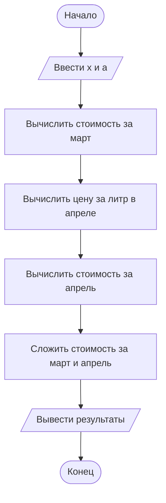

# Домашнее задание к лабораторной работе № 2

## 1. Условие задачи

В течение месяца продавец доставлял на дом 4 л молока в день. В марте молоко стоило **x** руб. за литр. С первого апреля цена молока увеличилась на **(x + a)** руб. за литр. Сколько надо заплатить продавцу за всё доставленное молоко в конце апреля? Количество покупаемого молока осталось прежним.

## 2. Алгоритм и блок-схема

1. Начать работу программы.
2. Ввести цену молока в марте `x` и величину увеличения цены `a`.
3. Вычислить стоимость молока за март: `total_march = 4 * 31 * x`.
4. Вычислить цену молока в апреле: `price_april = x + (x + a)`.
5. Вычислить стоимость молока за апрель: `total_april = 4 * 30 * price_april`.
6. Найти общую сумму: `total = total_march + total_april`.
7. Вывести стоимость за март, за апрель и общую сумму.
8. Завершить работу программы.



## 3. Реализация программы

```c
#include <stdio.h>

int main()
{
    double x, a;
    double price_april;
    double total_march, total_april, total;

    printf("Введите цену литра молока в марте (x): ");
    if (scanf("%lf", &x) != 1)
    {
        printf("Ошибка ввода.\\n");
        return 1;
    }

    printf("Введите величину увеличения цены (a): ");
    if (scanf("%lf", &a) != 1)
    {
        printf("Ошибка ввода.\\n");
        return 1;
    }

    price_april = x + (x + a);
    total_march = 4.0 * 31.0 * x;
    total_april = 4.0 * 30.0 * price_april;
    total = total_march + total_april;

    printf("Стоимость молока за март: %.2f руб.\\n", total_march);
    printf("Стоимость молока за апрель: %.2f руб.\\n", total_april);
    printf("Всего к оплате: %.2f руб.\\n", total);

    return 0;
}
```

## 4. Результаты работы программы

Пример проверки на тестовых данных: `x = 50`, `a = 10`. Эти значения выбраны только для демонстрации работы программы.

```text
Введите цену литра молока в марте (x): 50
Введите величину увеличения цены (a): 10
Стоимость молока за март: 6200.00 руб.
Стоимость молока за апрель: 13200.00 руб.
Всего к оплате: 19400.00 руб.
```

## 5. Информация о разработчике

**Хром А. И.**, группа **бИД-261**.
 